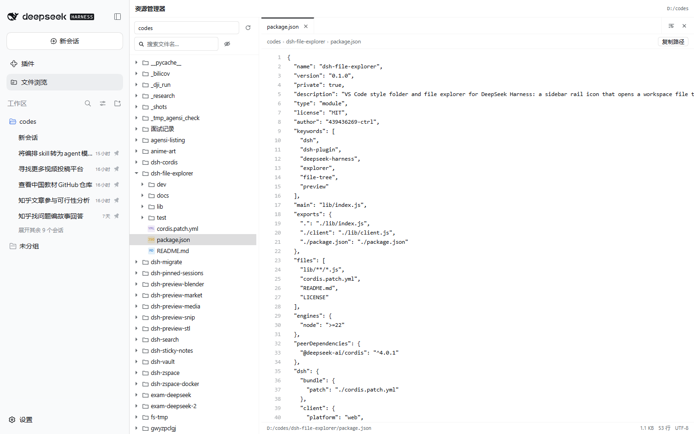
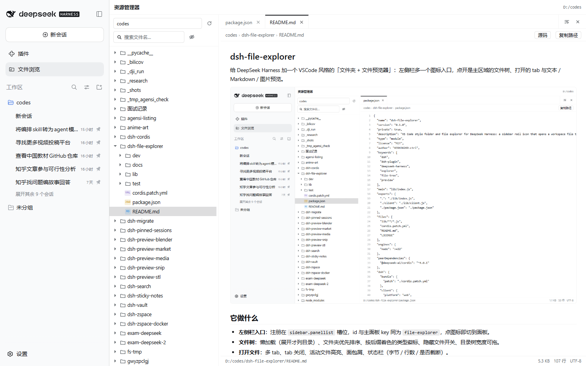
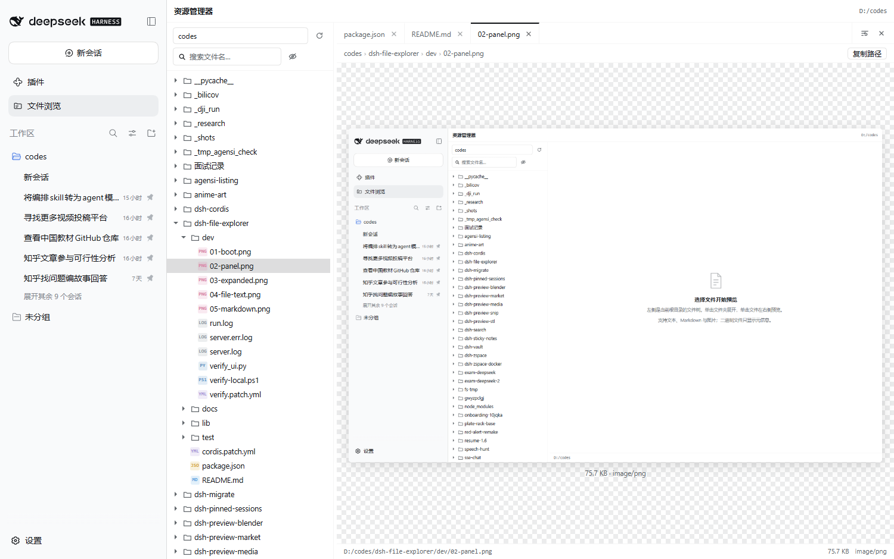
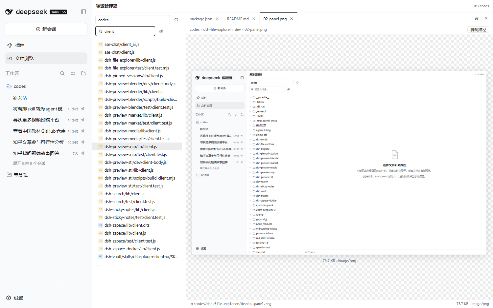

# @vfvrpq/dsh-file-explorer

[](https://www.npmjs.com/package/@vfvrpq/dsh-file-explorer)
[](LICENSE)

给 DeepSeek Harness 加一个 VSCode 风格的「文件夹 + 文件预览器」：左侧栏多一个图标入口，点开是主区域的文件树、打开的 tab 与文本 / Markdown / 图片预览。



> npm 上的 `dsh-file-explorer` 是另一个作者的同名插件，本包使用 `@vfvrpq/` scope 区分，两者不冲突、可共存。

## 界面

| 文件树 + 代码预览 | Markdown 渲染 |
|---|---|
|  |  |

| 图片预览 | 文件名搜索 |
|---|---|
|  |  |

## 它做什么

- **左侧栏入口**：注册在 `sidebar.panellist` 槽位，id 与主面板 key 同为 `file-explorer`，点图标即切到面板。
- **文件树**：懒加载（展开才列目录）、文件夹优先排序、按后缀着色的类型徽标、隐藏文件开关、目录树宽度可拖。
- **打开文件**：多 tab、tab 关闭、活动文件高亮、面包屑、状态栏（字节 / 行数 / 是否截断）。
- **预览**：
  - 文本：等宽字体 + 行号 + 自动换行开关，单文件默认最多 1 MiB、最多渲染 4000 行；
  - Markdown：标题 / 列表 / 引用 / 代码块 / 链接 / 图片，相对图片走原始字节路由，可一键切回源码；
  - 图片：png / jpg / gif / webp / avif / bmp / ico / svg；
  - 其它二进制：只显示类型与大小，不加载内容。
- **搜索**：按文件名在当前根目录内递归搜索（受目录数、命中数、时间三重预算约束）。

## 安装

DSH 0.2 预览版，插件是标准 bundle（包内带 `dsh.bundle.patch`）：

```bash
# 装进某个 profile（会同时写 dependencies 与 dsh.profile.bundles）
dsh plugin --profile desktop add @vfvrpq/dsh-file-explorer@0.1.0
```

或者手写进 profile 的 `package.json`：

```jsonc
{
  "dependencies": { "@vfvrpq/dsh-file-explorer": "0.1.0" },
  "dsh": { "profile": { "bundles": [ ..., "@vfvrpq/dsh-file-explorer" ] } }
}
```

也可以只在 profile 的 `cordis.patch.yml` 里挂一行（**两种方式不要同时用**，`insert` 不按 id 去重，会挂载两次）：

```yaml
- insert:
    - id: file-explorer
      name: "@vfvrpq/dsh-file-explorer"
      config:
        enabled: true
```

宿主半随 Host 启动加载，客户端半由页面加载；装好后重启一次 DSH（或让 Loader 重载），侧栏就会出现「文件浏览」图标。

> 不要用 `link:` / 目录 junction 安装：`@deepseek-ai/schemastery` 由宿主在 profile 的 `node_modules` 里解析，软链会被 Node 还原成源码真实路径，从那里向上找不到宿主包，插件会以 `failed to import` 静默不激活。用 npm 安装或 `file:` tar 包（真实拷贝）。

## 配置

配置层在 `cordis.patch.yml` 的 `config` 下，字段与默认值：

| 字段 | 默认 | 说明 |
|---|---|---|
| `enabled` | `true` | 关掉后路由不再响应，但侧栏入口仍在 |
| `routePath` | `/api/file-explorer` | 认证路由，必须以 `/api/` 开头才能吃到连接层的鉴权围栏 |
| `extraRoots` | `[]` | 额外可浏览的绝对目录（除了工作区、默认目录、进程目录、主目录） |
| `includeHome` | `true` | 是否把用户主目录作为根 |
| `ignored` | `[]` | 列表与搜索里隐藏的条目名，例如 `node_modules` |
| `maxTextBytes` | `1048576` | 文本预览上限（超出截断并标注） |
| `maxRawBytes` | `33554432` | 原始字节路由上限（图片预览） |
| `defaultShowHidden` | `false` | 文件树初始是否显示点文件 |

## 权限模型

这个插件只读，并且**不接受任意路径**：

1. 可浏览的根 = 已注册工作区 + 默认工作目录 + 进程目录 + 主目录 + `extraRoots`，去重后只保留真实存在的目录；
2. 每次请求的 `path` 都会用 `ctx.fs.resolve` 解析成稳定 target，再用 `ctx.fs.contains(root, target)` 证明它落在某个根内，否则 403；
3. 路由挂在 `/api/` 下，继承连接层的 Host/Origin 校验与会话 cookie 鉴权；
4. 原始字节路由只对图片类型内联（带 `nosniff` + `CSP sandbox`），其它一律按附件下发，避免同源 HTML/SVG 被执行。

## 目录结构

```
lib/index.js    接线：name / inject / Config / apply，注册路由 + 下发客户端配置
lib/config.js   默认值与归一化（可脱离宿主单测）
lib/schema.js   schemastery 配置（设置页用）
lib/roots.js    根目录候选、解析、去重、路径围栏
lib/files.js    列目录、读预览、递归搜索（全部走 ctx.fs）
lib/route.js    GET /api/file-explorer?op=roots|list|read|search|raw
lib/client.js   浏览器半：侧栏图标 + 主面板（无构建，手写 ModuleLoader bundle）
test/           宿主单测 + 客户端 bundle 的结构断言
docs/           验证截图
dev/            临时 profile 端到端验证脚本
```

依赖方向严格单向：`index → route → files/roots → config`，客户端只经 HTTP 路由取数据。

## 开发与验证

```powershell
# 宿主与客户端结构单测（20 项，不需要 DSH 运行时）
node --test test\host.test.mjs test\client.test.mjs

# 端到端：建临时 profile → 装包 → 起无头 Web → Playwright 断言 17 项 → 拆掉
powershell -NoProfile -ExecutionPolicy Bypass -File dev\verify-local.ps1
```

端到端脚本会验证：侧栏图标存在、面板挂载、树懒加载、`roots` 接口、文本预览内容与行号、Markdown 渲染与源码切换、Markdown 相对图片真的解码（读 `naturalWidth`）、图片预览解码、状态栏跟随活动文件、搜索命中、刷新后仍可用。截图落在 `dev/`，可复制到 `docs/`。

## 已知限制

- 只读：不提供保存、重命名、删除，避免和会话的写权限、审批策略打架。
- 无语法高亮：只做行号与类型着色，不做 tokenizer。
- 单文件渲染上限 4000 行；文本读取上限 1 MiB（都可配）。
- 搜索是文件名子串匹配，不是内容检索；单次最多开 400 个目录、4 秒预算。
- 二进制文件不给下载按钮（原始路由只服务图片内联）。

## License

MIT
